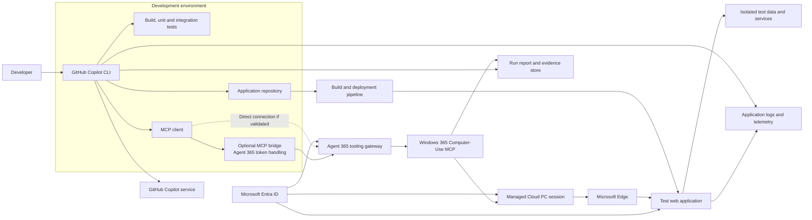

# Reference Architecture: GitHub Copilot CLI Testing with Windows 365 for Agents

**Status:** Proposed reference architecture

**Date:** November 20, 2026

**Primary audience:** Application developers, identity administrators, platform engineers, security teams, and test engineers

## 1. Executive summary

This architecture uses **GitHub Copilot CLI** to investigate and fix an application while using **Windows 365 for Agents** as an authenticated, managed browser environment for end-to-end testing.

Copilot CLI operates from a development workstation or approved development environment. It reads the application repository, runs local checks, invokes browser actions through MCP, analyzes failures, and proposes or implements fixes. A Windows 365 Cloud PC opens the deployed test application in Microsoft Edge using a dedicated Microsoft Entra agent user identity.

**Deployment topology decision (November 18, 2026):** The agent runs on the Cloud PC itself rather than on a developer workstation. The Cloud PC is provisioned from the Windows 365 developer image, and Intune installs the remaining software (see section 8.3). The agent user's Microsoft Entra sign-in is the root credential for the session; the agent reaches Azure Key Vault and Azure DevOps with that sign-in, and only non-Entra services need stored secrets (see sections 6.4 and 6.5). Sections 4, 5, and 7 still describe the workstation-hosted variant and should be revised once the on-device browser control mechanism is decided (see section 18).

**Driver decision (November 20, 2026):** GitHub Copilot CLI replaces Claude Code CLI as the agent that runs on the Cloud PC. This was a product decision by the owner. The consequence is that model access is no longer reached with the agent user's Entra sign-in through Microsoft Foundry; it needs a GitHub credential, which changes the credential model in section 6.4 and the provisioning sequence in section 6.5. Everything in the design that is not about the agent binary (topology, Windows 365 session model, Key Vault, test strategy, evidence) is unchanged. "Copilot CLI" in this document means the GitHub Copilot CLI terminal agent (`copilot`, npm package `@github/copilot`), not the retired `gh copilot` extension and not Copilot in Windows Terminal.

The core workflow is:

1. Start a test run from Copilot CLI.
2. Acquire a Windows 365 agent session.
3. Authenticate to the application through the agent's Entra-backed session.
4. Exercise a defined user journey and capture evidence.
5. Triage any failure against application code, logs, and deployment information.
6. Implement a fix and run appropriate local tests.
7. Deploy the candidate build to a test environment.
8. Repeat the failing journey and run relevant regression tests.
9. Produce a report linking the result, evidence, and code change.

**Integration decision requiring validation:** Microsoft documents the Windows 365 Computer-Use server as an MCP endpoint protected by an Agent 365 agent-user token. Copilot CLI is an MCP client that supports stdio, HTTP, and SSE servers and documents OAuth settings for remote servers, including the client-credentials grant. That makes a direct connection more plausible than it was with the previous driver, but compatibility between Copilot CLI's OAuth handling and this particular agent-user token flow must still be proven in the target tenant. If direct integration is insufficient, a small, controlled MCP bridge can obtain and refresh the required token using the Microsoft-recommended identity libraries and forward permitted calls.

Microsoft's [Windows 365 authentication reference](https://github.com/microsoft/windows-365-for-agents/blob/main/docs/authentication.md) and [computer-use MCP reference](https://learn.microsoft.com/en-us/microsoft-copilot-studio/mcp-windows-365-agents) describe the underlying interfaces.

## 2. Goals and non-goals

### Goals

- Test an Entra-protected web application as a dedicated agent user.
- Give Copilot CLI enough browser access to reproduce and verify real user journeys.
- Enable Copilot CLI to inspect the repository and make targeted fixes.
- Preserve evidence that links a test result to a specific application build and code revision.
- Apply least privilege to the agent identity, test data, Cloud PC, and development environment.
- Support both exploratory testing and repeatable regression coverage.
- Make authentication, network access, and session failures distinguishable from application defects.

### Non-goals

- Replacing a deterministic CI test suite with agent-driven exploration.
- Granting the agent access to production data by default.
- Assuming that a successful Cloud PC sign-in automatically authorizes access to the application.
- Treating an MCP server URL as sufficient proof that a client can complete the required identity flow.
- Automatically promoting unreviewed fixes to production.

## 3. Design principles

| Principle | Architectural consequence |
|---|---|
| Separate control and test environments | Copilot CLI runs where it can access source code; the Cloud PC runs the browser. |
| Use explicit identities | The developer, agent identity, agent user, GitHub identity, application, and deployment identity each have defined roles. |
| Bind results to a build | Every run records the source revision and the deployed build identifier. |
| Prefer test data | Seed isolated, synthetic data and make cleanup repeatable. |
| Design for disposable sessions | Persist useful artifacts outside the Cloud PC before release. |
| Treat observations as evidence | Screenshots, logs, test assertions, and source references support conclusions. |
| Preserve human control | Changes and deployment follow the organization's existing review and release process. |

## 4. Logical architecture

The diagram is logical. It does not imply that the Cloud PC can reach the developer's machine or that every connection is available without tenant-specific configuration.

## 5. Component responsibilities

| Component | Responsibility |
|---|---|
| **Developer** | Starts or supervises work, defines the test objective, reviews changes, and follows the organization's deployment controls. |
| **GitHub Copilot CLI** | Interprets the test objective, coordinates tools, examines code and evidence, implements scoped changes, and reports results. Sends prompts and tool output to the GitHub Copilot service for inference. |
| **Repository and local tools** | Supply source code, build configuration, unit tests, integration tests, and deployment definitions. |
| **MCP client** | Makes tool calls from Copilot CLI to the selected computer-use integration. |
| **Optional MCP bridge** | Provides a controlled adapter if Copilot CLI cannot directly satisfy the Windows 365 server's agent-user authentication requirements. |
| **Agent 365 tooling gateway** | Exposes authorized agent tooling, including Windows 365 Computer-Use, subject to the configured identity and consent. |
| **Windows 365 for Agents** | Allocates, manages, and resets Cloud PC sessions for the agent. |
| **Cloud PC and Edge** | Execute the browser journey within the managed Windows environment. Microsoft's DOM-level browser tools target Edge. |
| **Microsoft Entra ID** | Authenticates relevant identities and applies applicable access policies. |
| **GitHub Copilot service** | Performs model inference for Copilot CLI and enforces the enterprise Copilot policies, seat or App billing, and model enablement. |
| **Test application** | Implements application authentication and authorization; exposes testable user workflows. |
| **CI/CD pipeline** | Builds and deploys a known application revision to the test environment. |
| **Evidence store** | Retains permitted screenshots, logs, and results beyond the life of a Cloud PC session. |

Microsoft documents the Windows 365 server's browser and desktop capabilities, including its Edge limitation, in the [MCP server reference](https://learn.microsoft.com/en-us/microsoft-copilot-studio/mcp-windows-365-agents).

## 6. Identity and authentication architecture

### 6.1 Identity inventory

| Identity | Purpose | Recommended access |
|---|---|---|
| **Developer identity** | Runs Copilot CLI interactively and accesses the repository and development tools. | Developer-level permissions governed by existing controls. |
| **Agent blueprint** | Defines the agent's identity and permissions configuration in Entra and Agent 365. | Only permissions required for the selected agent and tooling. |
| **Agent identity** | Represents the agent for supported token flows and agent-level governance. | Access to the required Windows 365 tooling and assigned pool, subject to the documented flow. |
| **Agent user** | Provides the user-like identity used within the agent's Windows session and application access. | Dedicated test-application roles and access to synthetic data. |
| **GitHub identity for the agent** | Gives Copilot CLI a credential for model inference and gives git a credential for the repository. Either a GitHub App installation (preferred) or a dedicated Enterprise Managed User account that holds a Copilot seat. | "Copilot Requests" permission plus the minimum repository permissions; no organization administration. |
| **Application identity** | Represents the application or its protected APIs in Entra. | Its normal resource and API permissions. |
| **Deployment identity** | Deploys the tested application build. | Restricted to the target test environment and deployment mechanism. |

The exact claims and identity subject visible to the application must be verified in the tenant and application. Do not assume that an agent-user browser session is equivalent to application-only access or a human user's delegated access.

### 6.2 Two authentication boundaries

**Boundary A: Copilot CLI to Windows 365 computer-use tools**

1. The agent's blueprint and identity are configured in Agent 365.
2. The Windows 365 Computer-Use MCP server is added to the agent configuration and consented.
3. An authorized client obtains an agent-user token for the required audience.
4. The client calls the Agent 365 tooling gateway and starts a Cloud PC session. The server exposes StartSession, EndSession, and GetSessionDetails.
5. Tokens are refreshed as required for the duration of the run.

Microsoft recommends using the Agent 365 SDK or supported identity libraries for the token exchange. Its reference also describes direct MCP calls using an appropriate bearer token. [Microsoft: Windows 365 authentication](https://github.com/microsoft/windows-365-for-agents/blob/main/docs/authentication.md).

**Boundary B: Cloud PC browser to application**

1. The agent session starts under its associated agent user.
2. Edge navigates to the application.
3. Entra and the application evaluate authentication and access policy.
4. The application authorizes the resulting identity according to its own roles, groups, claims, and business rules.

Microsoft describes enterprise SSO within the authenticated Cloud PC session. Whether a particular application accepts the agent user and its claims must be tested. [Microsoft: agent authentication model](https://learn.microsoft.com/en-us/windows-365/agents/agent-authentication-model).

### 6.3 Conditional Access and role design

- Define application roles for the user journeys being tested.
- Use separate agent users or appropriately isolated role configurations when testing materially different permissions.
- Target policies to the correct subject. Microsoft distinguishes agent identities, agent users, and users in on-behalf-of flows; a policy targeting one does not automatically cover the others.
- Validate device compliance, network requirements, token issuance, and any interactive authentication requirements with the identity team.
- Do not weaken production policies solely to make the test pass.
- Record the actual Entra sign-in failure and policy outcome when access is denied.

Microsoft Entra Agent ID is generally available, but parts of Conditional Access for agents remain in preview: the "Agent execution environments" condition used for Cloud PC sessions, the "Agents" and "All agent users" targeting options, agent risk, and the block-high-risk-agents template. Policies must target agent users under Assignments > Agents, because policies scoped to ordinary users do not apply to them. Conditional Access is evaluated when Entra issues or refreshes tokens, with continuous access evaluation for some resources, rather than only once at session start. Licensing requires Microsoft 365 E7, or an Agent 365 license plus Microsoft Entra ID P1 or Microsoft 365 E3. Verify tenant availability before relying on any preview capability. [Microsoft: Conditional Access for agents](https://learn.microsoft.com/en-us/entra/identity/conditional-access/agent-id).

### 6.4 Credential model

The agent user's Entra sign-in is the root credential for the Azure-side services the agent uses on the Cloud PC. Services that accept Entra tokens are reached with that sign-in and need no stored secret. Model inference is the exception: Copilot CLI authenticates to GitHub, not to Entra, so it needs a GitHub credential that is delivered at session start. Only services that cannot accept Entra tokens need a stored or brokered secret, and those are fetched at session start.

| Consumer | Credential | Mechanism | Stored secret on device? |
|---|---|---|---|
| **Copilot CLI model access** | GitHub token presented in `COPILOT_GITHUB_TOKEN` or stored in Windows Credential Manager | **Primary (must be proven):** the same GitHub App broker that mints source-control tokens also mints a one-hour installation token carrying the organization permission "Copilot Requests: read". GitHub documents this token type for the Copilot SDK and for GitHub Actions, where it is billed to the organization and needs no signed-in user; it is not documented for the standalone CLI, although the CLI accepts `ghu_` tokens. **Fallback:** a fine-grained personal access token with the "Copilot Requests" permission, owned by a dedicated Enterprise Managed User account that holds a Copilot seat, stored in Azure Key Vault and fetched at session start. Classic PATs are rejected. **Watch item:** Copilot CLI's Microsoft Entra sign-in (public preview, November 17, 2026) is interactive only; if a headless flow appears, model access can be re-rooted in the agent user's Entra sign-in. **Rejected for now:** bring-your-own-key to Microsoft Foundry or Azure OpenAI, because it needs an API key and GitHub states that local BYOK is not governed by enterprise policy. Model traffic leaves the Azure tenant for the GitHub Copilot service. | Primary: no long-lived secret. Fallback: yes, session-scoped, lifetime capped by the enterprise PAT policy (up to 366 days), rotation required. |
| **Azure Key Vault** | Agent user Entra token | Silent token acquisition through the Windows broker (WAM) using the operating system account: MSAL with OperatingSystemAccount, or an Azure Identity library with its default broker account option and broker package. Silent success is not guaranteed and WAM falls back to an interactive prompt, so the bootstrap must fail closed. WAM requires an active interactive Windows user session and does not work from a service or scheduled task running under another account. The Key Vault Secrets User role is assigned to the agent identity, or to an Entra group the agent user belongs to, on a vault dedicated to that agent. Microsoft documents Azure RBAC for agent identities but not for agent users, so this assignment path is untested. | No |
| **Source control (Azure DevOps)** | Agent user Entra token | Entra tokens are accepted directly by Azure DevOps. | No |
| **Source control (GitHub)** | Short-lived GitHub App installation token | The same broker service as the model-access row mints an installation token with repository permissions on request. The token is written to a git credential helper, never to a file or environment variable the model can print. If the primary model-access path is proven, one broker and one App serve both needs. | No long-lived secret |
| **Linear** | Linear API key for a dedicated bot identity | Stored in Key Vault, fetched at session start, and placed in the MCP server configuration so the model calls tools but never sees the key. | Yes, session-scoped |
| **Windows 365 Computer-Use MCP** | Agent-user token for the `mcp_W365ComputerUse` audience | Obtained through the Agent 365 SDK or the optional bridge, as described in section 6.2. | No |

Rules that apply regardless of mechanism:

- Do not place bearer tokens, passwords, client secrets, or session cookies in prompts, source control, screenshots, or test reports.
- Keep token acquisition and refresh within the bridge, credential helper, or supported SDK, rather than exposing tokens to the agent as tool output. Anything in an environment variable or on disk under the agent user's profile is readable by the model through its shell tool. Copilot CLI reads `COPILOT_GITHUB_TOKEN` from the environment and lets an environment variable override the stored credential, so the bootstrap should store the token in Windows Credential Manager (service name `copilot-cli`) rather than in the process environment, and keep its lifetime short.
- Rotate credentials according to organizational policy and revoke them when an agent is retired.
- Avoid storing a reusable authenticated browser profile as the foundation of the design.

### 6.5 Session-start secret provisioning

There is no built-in tool that delivers Key Vault secrets to a Windows 365 Cloud PC at provisioning time, and provisioning time is the wrong moment in any case:

- The Azure Key Vault VM extension runs only on Azure VMs and Azure Arc-enabled servers and authenticates with a managed identity. It refreshes certificates into the certificate store rather than delivering arbitrary secrets such as API keys, and Microsoft lists only Windows Server 2022 and 2025 as supported, so Windows 11 Cloud PCs are not listed. Microsoft documents no assignable managed identity for Cloud PCs, although they must reach the Azure instance metadata endpoint. Treat the absence of an identity as undocumented rather than proven.
- Azure Arc would add a system-assigned managed identity through a local endpoint, but agent pool machines are reset after every session, so each reset would need onboarding again. Microsoft's guidance against Arc on ephemeral or VDI machines was not verified in the fact-check and should be confirmed before it is cited.
- Intune has no Key Vault integration for secrets, and its PowerShell script guidance states that scripts must not contain passwords or sensitive data, and scripts are stored locally on the device. Intune can deliver the bootstrap script, but not the secret.
- Pool machines are provisioned once and checked out per task. Anything placed at provisioning time is shared across every agent that later uses the machine and persists in the image.

The provisioning sequence is therefore:

1. Intune delivers the bootstrap script, the Copilot CLI managed settings (registry policy under `HKLM\SOFTWARE\Policies\GitHubCopilot`, or `%ProgramFiles%\GitHubCopilot\managed-settings.json`), machine policy hooks under `C:\ProgramData\GitHub\Copilot\policy.d`, and the machine-wide MCP server configuration to the image. None of these contain secrets.
2. At session start, after the agent user is signed in, the bootstrap script runs under the agent user.
3. The script acquires a Key Vault token silently through the Windows broker using the operating system account, inside the agent user's interactive session, and stops if the broker asks for interaction.
4. The script fetches only the secrets listed in the inventory above and writes each into its credential helper or MCP server configuration.
5. The script obtains the GitHub token for Copilot CLI (an installation token from the broker, or the fallback PAT from Key Vault) and stores it in Windows Credential Manager for the agent user under the `copilot-cli` service name. It sets `COPILOT_AUTO_UPDATE=false` and pins `COPILOT_MODEL`, and it does not export the token as an environment variable.
6. Copilot CLI starts in non-interactive prompt mode. The session reset at checkin disposes of every fetched value.

Conditional Access for the agent user must permit the Key Vault and Azure DevOps audiences. Parts of Conditional Access for agents are preview, as described in section 6.3.

**Must be proven in the target tenant before this model is adopted:**

- Azure RBAC roles (Key Vault Secrets User) reach the agent user's token. Microsoft documents RBAC assignment for agent identities and states that blueprints cannot hold Azure RBAC roles, but says nothing about agent users. Prove either direct assignment to the agent user or assignment through an Entra group the agent user joins. Directory roles such as Global Administrator are blocked for agent identities and are not needed here.
- Silent broker sign-in for the agent user works inside an agent session on the Cloud PC. Microsoft describes enterprise SSO within the session but does not document a Primary Refresh Token or broker behavior for agent users, and the broker documentation says nothing about agent users, headless sessions, or Cloud PCs. A silent attempt can also fail and prompt interactively.
- The standalone Copilot CLI accepts a GitHub App installation token that carries "Copilot Requests: read", outside GitHub Actions. GitHub documents this token type for the Copilot SDK and Actions only.
- The enterprise has enabled the Copilot CLI client for the agent's organization and, for the primary path, allows Copilot requests from App installations billed to the organization.
- The managed settings precedence behaves as the deployment guide states (MDM, then server-managed, then file, then user), because the configuration directory reference says users can override most managed keys.

## 7. MCP integration options

### Option A: Direct Copilot CLI connection

Configure Copilot CLI to connect to the Windows 365 MCP endpoint using the supported transport and an authentication flow accepted by that endpoint. Copilot CLI's MCP configuration documents HTTP and SSE transports and OAuth fields for client ID, scopes, public clients, and the authorization-code or client-credentials grant.

**Advantages**

- Fewer components to maintain.
- Fewer network hops and a simpler local experience.

**Validation required**

- Does the endpoint expose an authentication flow that the installed Copilot CLI version can complete?
- Does the resulting token represent the required agent user and audience?
- Are refresh, session lifecycle, tool discovery, and all required calls supported?
- Are tenant governance, consent, and audit requirements met, including the enterprise MCP allowlist?

A successful OAuth connection to another Agent 365 server is not by itself proof that the Windows 365 endpoint accepts the same identity flow.

### Option B: Local MCP bridge

Copilot CLI connects to a locally hosted bridge. The bridge uses the supported Microsoft identity mechanism to authenticate to the gateway and forwards an approved subset of computer-use tools.

**Recommended fallback when Option A cannot satisfy the required authentication flow.**

Suggested bridge responsibilities:

- Obtain and refresh the appropriate agent-user token.
- Forward MCP requests and responses without exposing credentials to the model.
- Restrict tools, destinations, and session scope to the test use case.
- Associate each call with a run ID and session ID.
- Apply timeouts, safe error handling, and structured logging.
- Release sessions on completion or cancellation.
- Avoid recording sensitive page content or tokens in operational logs.

The bridge introduces a component that must be implemented, secured, versioned, and maintained. Its ability to use the chosen SDK and transport should be established during the proof of concept.

### Option C: Custom GitHub Copilot SDK orchestrator

Build a custom agent using the GitHub Copilot SDK and Microsoft's Agent 365 integrations. The SDK became generally available on June 2, 2026, runs the same agent engine as the CLI, is published for TypeScript, Python, Go, .NET, Rust, and Java, and documents authentication with GitHub App installation tokens as well as bring-your-own-key providers including Microsoft Foundry.

This option offers more control over identity and orchestration but changes the primary user experience from the requested Copilot CLI workflow. It is appropriate if direct or bridged CLI integration proves impractical. It is distinct from the GitHub-hosted Copilot cloud agent, which works on issues and pull requests inside GitHub and is governed by a separate policy.

## 8. Network and environment design

### 8.1 Application reachability

The Cloud PC must be able to resolve and reach the application URL and any required identity and supporting endpoints.

- For a publicly reachable test application, restrict access using appropriate identity and network controls.
- For a private application, design and verify a supported private connectivity and DNS path for the Cloud PC pool.
- Verify redirects, API calls, static assets, and any dependent services, not just the initial page.
- Treat `localhost` as local to the Cloud PC. A server running on the developer's workstation is not automatically available there.
- Use an approved test deployment or an explicitly approved development-access mechanism where local changes need remote browser verification.

The Copilot CLI environment also needs access to the repository, build tools, selected MCP connection, the GitHub Copilot service, and whatever approved telemetry or deployment interfaces it uses.

### 8.2 Environment separation

| Environment | Purpose | Data and access |
|---|---|---|
| **Local development** | Implement fixes and run fast checks. | Developer-controlled configuration and local test data. |
| **Shared test or isolated preview** | Browser-based verification of a known deployed build. | Synthetic data, restricted agent roles, and controlled integrations. |
| **Production** | Live application service. | Outside the default automated test and fix loop. Any production verification requires an explicit operating policy. |

Prefer isolated preview environments when simultaneous work could cause one test run to overwrite another run's deployment or data.

### 8.3 Device provisioning

The Cloud PC pool is provisioned from the Windows 365 developer image. Intune installs the remaining software and configuration.

| Delivered by | Content | Notes |
|---|---|---|
| **Developer image** | Base operating system and the developer tooling the image ships with. | Verify the actual image contents (for example Git, Node, VS Code) before assuming anything is present. Copilot CLI installed through npm needs Node.js 22 or later; the winget package does not. |
| **Intune, Win32 or winget apps** | Copilot CLI, MCP servers, helper tools. | Install machine-wide with a pinned version (winget `GitHub.Copilot` with an explicit version, or npm `@github/copilot@<version>`). Set `COPILOT_AUTO_UPDATE=false` so a mid-run update, or a newer cached version, cannot change behavior. |
| **Intune, device configuration** | Copilot CLI managed settings delivered as registry policy under `HKLM\SOFTWARE\Policies\GitHubCopilot` (permission allow, ask, and deny rules; `disableBypassPermissionsMode`; pinned `model`; telemetry settings), machine policy hooks in `C:\ProgramData\GitHub\Copilot\policy.d`, the enterprise MCP allowlist reference, git global configuration (user name, email, credential helper), bootstrap script. | Managed settings and policy hooks cannot be removed by the user or the model, which is the mechanism for unattended permission control. Contains no secrets. |
| **Session-start bootstrap** | Secrets and short-lived tokens. | See section 6.5. Never delivered by Intune. |

Constraints:

- **Time to readiness.** If the pool reprovisions from the image after every reset, every Intune app install runs again before the agent can start. Bake heavy software into a custom image and leave Intune for policy to keep readiness short. Section 15 monitors time to readiness, so this is a measurable constraint.
- **Targeting.** User-scoped Intune policy applies only if the agent user is licensed and targetable. Assume device-scoped targeting of the pool until the identity team confirms otherwise.
- **Pool support.** Confirm that Windows 365 for Agents pools accept custom images and full Intune management in the target tenant. Microsoft describes agent Cloud PCs as "domain-joined" and Intune-managed on a pool basis rather than per device. Do not read this as on-premises Active Directory join. Copilot Studio and other first-party agents create pools in their own portals without Intune setup, while the Agent 365 path uses a provisioning policy for agents. Custom image support must be verified separately.
- **Hooks fail open.** GitHub documents that a Copilot CLI hook that times out (default 30 seconds) is treated as allowed, including machine policy hooks. Use managed `permissions.deny` rules for hard limits and treat hooks as an audit and shaping layer only.
- **Egress.** In addition to the application endpoints in section 8.1, the Cloud PC must reach the GitHub Copilot service and github.com endpoints (exact hostnames per GitHub's network allowlist documentation, to be confirmed), Azure Key Vault, the source control host, and Linear.

## 9. End-to-end workflow

### Phase 1: Prepare the run

1. The developer states the objective, target environment, and expected behavior.
2. Copilot CLI identifies the repository revision and working-tree state.
3. The test environment exposes or otherwise records its deployed build identifier.
4. The run receives a unique run ID.
5. Test data is seeded or selected, and permitted side effects are defined.

### Phase 2: Acquire and authenticate

1. Copilot CLI invokes the Windows 365 MCP integration.
2. The integration starts a Cloud PC session and waits for readiness.
3. The agent opens the application in Edge.
4. The test verifies the signed-in identity and expected role where practical.
5. If authentication fails, the run records the failure as an environment or identity issue until evidence indicates an application defect.

### Phase 3: Exercise the journey

1. Navigate through the requested workflow.
2. Record expected and actual behavior at meaningful checkpoints.
3. Capture allowed screenshots and relevant application or browser diagnostics.
4. Identify the reproducible steps, test data, and build version.
5. Classify the outcome as pass, fail, blocked, or inconclusive.

### Phase 4: Triage and fix

1. Correlate the failure with application telemetry and source code.
2. Separate product defects from test-data, identity, deployment, network, and infrastructure failures.
3. Implement a targeted fix when the evidence supports one.
4. Add or update a regression test when it meaningfully protects against recurrence.
5. Run the relevant local checks.
6. Report residual uncertainty rather than claiming a fix based only on code inspection.

### Phase 5: Deploy and verify

1. Build the candidate revision and deploy it through the approved test pipeline.
2. Confirm the running environment reports the intended build.
3. Re-run the original failing scenario.
4. Run a proportionate set of related regression checks.
5. Save the report and evidence outside the Cloud PC.
6. End the session and release the Cloud PC.

Windows 365 agent sessions are reset after use. Microsoft also documents inactivity eviction and independent token lifetimes; orchestration must handle session loss and reacquisition. Copilot CLI keeps its own session state under the agent user's profile, which the reset also discards, so a resumed run starts from the evidence store rather than from the CLI's session history. [Microsoft: session lifecycle](https://learn.microsoft.com/en-us/windows-365/agents/agent-session-lifecycle).

## 10. Testing strategy

| Layer | Purpose | Typical owner or tool |
|---|---|---|
| Unit | Check isolated business rules quickly. | Repository test suite. |
| Integration | Validate application components and service boundaries. | Repository or CI test suite. |
| Deterministic end-to-end | Protect critical paths with repeatable assertions. | Existing browser automation and CI tooling. |
| Agent-driven exploration | Investigate failures, discover unexpected behavior, and exercise less-scripted flows. | Copilot CLI with Windows 365 computer-use tools. |
| Identity and access | Confirm sign-in, role enforcement, and policy outcomes. | Dedicated scenarios using approved identities. |
| Visual and usability review | Identify apparent layout or interaction issues. | Screenshots and human review where needed. |

Agent observations are valuable but can be variable. Convert stable, high-value findings into deterministic tests when practical. A screenshot alone does not prove that a workflow's backend state is correct; verify the relevant observable result or supported test interface.

### Recommended initial scenarios

- Agent user reaches the application and is recognized as the expected role.
- Authorized user completes a representative create, read, update, and delete journey using synthetic data, where those actions are allowed.
- Restricted role is denied an action it should not perform.
- Validation errors appear for invalid input.
- A known defect is reproduced, fixed, redeployed, and retested.
- Session expiration or loss is reported as an infrastructure interruption rather than a product pass.

## 11. Test data and side effects

- Use a dedicated test tenant, database, or logical partition where practical.
- Seed data with run-specific identifiers so concurrent runs do not interfere.
- Ensure test records do not contain real customer information unless explicitly approved.
- Replace or constrain external integrations such as payment, email, and messaging providers in the test environment.
- Make cleanup repeatable and record cleanup failures.
- Define which actions are safe for autonomous testing and which require a human decision.
- Do not assume a failed or interrupted browser step had no side effect; inspect the resulting state before retrying.

## 12. Observability and evidence

### 12.1 Minimum run record

| Field | Example purpose |
|---|---|
| Run ID and timestamps | Correlate all activity. |
| Test objective and scenario | Explain what was attempted. |
| Environment and application URL | Identify the target. |
| Source revision and dirty-state indicator | Identify the code examined. |
| Deployed build identifier | Prove what the browser tested. |
| Agent identity or approved pseudonymous identifier | Attribute access without exposing credentials. |
| Cloud PC session identifier | Correlate session diagnostics. |
| Steps, expected result, actual result | Make the result reproducible. |
| Evidence references | Link approved screenshots, logs, and traces. |
| Outcome and failure classification | Distinguish pass, fail, blocked, and inconclusive. |
| Fix and verification references | Link the code change and subsequent test run. |

Where supported, propagate a correlation ID through application requests and telemetry. If browser tooling cannot inject one reliably, correlate using timestamps, run-specific test data, session details, and application logs.

### 12.2 Evidence handling

- Capture only evidence necessary to understand the result.
- Treat screenshots, DOM output, traces, and logs as potentially sensitive.
- Redact or avoid tokens, personal data, and confidential content.
- Apply access controls and retention rules to the evidence store.
- Preserve evidence before releasing the Cloud PC; session-local files are not durable storage.
- Record when diagnostics were unavailable so a reviewer understands the limits of the conclusion.
- Copilot CLI writes process logs and per-session event files under the agent user's `.copilot` directory and can sync sessions to GitHub, where they persist after local deletion. Decide whether synced sessions are evidence, a retention liability, or both, and configure the CLI's telemetry and OpenTelemetry export settings through managed settings so the run record, not the CLI's own history, is the system of record.

## 13. Security and governance

### Trust boundaries

1. **Cloud PC → GitHub Copilot service:** prompts, repository content, and tool output leave the tenant for inference. Apply the enterprise Copilot policies and the organization's data-handling review. Client-side telemetry can be disabled, but GitHub states this does not affect server-side telemetry.
2. **Copilot CLI → MCP integration:** restrict available tools and local bridge access with the enterprise MCP allowlist and managed permission rules.
3. **Bridge → Agent 365:** protect credentials and validate token audience and permissions.
4. **Cloud PC → application:** enforce Entra, application authorization, and network policy.
5. **Test run → external systems:** constrain integrations and side effects.
6. **Evidence → storage:** restrict access and retention.

### Controls

- Use a dedicated agent identity and least-privilege application roles.
- Restrict the Cloud PC pool to authorized agent identities.
- Use managed device and browser policies where supported.
- Treat page content, uploaded documents, logs, and tool responses as untrusted input; application content must not override the test objective or authorize unrelated actions. Copilot CLI also reads repository instruction files (`AGENTS.md`, `.github/copilot-instructions.md`, `CLAUDE.md`, `.claude/rules`) and hooks from `.claude/settings.json`, so a checked-out repository can shape the agent's behavior; treat those files as part of the reviewed code.
- Restrict shell execution and deployment permissions to what the workflow needs, using managed `permissions.deny` rules and `permissions.disableBypassPermissionsMode` so `--yolo` and `--allow-all` cannot be used on the device.
- Cap spend per run with `--max-ai-credits`.
- Keep code review, merge, and production-release controls in the existing development process.
- Review agent access, app role assignments, secrets, and evidence retention periodically.
- Disable the agent identity or revoke its permissions if misuse is suspected.

Microsoft describes the managed-device, identity, and governance controls in its [Windows 365 security overview](https://learn.microsoft.com/en-us/windows-365/agents/security-overview).

## 14. Failure handling and recovery

| Failure | Expected response |
|---|---|
| **MCP connection fails** | Check endpoint, transport, client configuration, gateway availability, and bridge health. Mark run blocked. |
| **401 or token expiry** | Check token audience, validity, acquisition, and refresh. Do not put tokens into the report. |
| **403 or authorization failure** | Check blueprint permissions, administrator consent, pool assignment, and gateway policy. |
| **Cloud PC unavailable** | Record capacity or provisioning failure; retry with bounded backoff according to operational policy. |
| **Session expires or resets** | Preserve prior evidence, acquire a new session, and resume only from a safe checkpoint. |
| **Application sign-in fails** | Inspect Entra sign-in and Conditional Access results and distinguish them from app-level authorization. |
| **Wrong build deployed** | Stop verification; deploy or identify the intended build before declaring results. |
| **Test action times out** | Inspect application state before retrying an action that may have completed. |
| **Application defect confirmed** | Capture reproduction, implement a scoped fix, and verify on the corrected build. |
| **Evidence incomplete** | Mark the result inconclusive or partially verified and state what is missing. |

Session cleanup should run on success, failure, and cancellation where possible. An operations process should also identify abandoned sessions and unexpected consumption.

## 15. Operational model

| Responsibility | Suggested owner |
|---|---|
| Application code, tests, and defect triage | Application team |
| Copilot CLI managed settings, GitHub App or seat administration, and repository access | Development platform team with the GitHub organization administrator |
| Agent identity, consent, and Conditional Access | Identity team |
| Cloud PC pool, image, network, and device policy | Endpoint or cloud platform team |
| Bridge implementation and maintenance, if needed | Development platform team |
| Test environment, data, and deployment pipeline | Application and platform teams |
| Security policy, evidence retention, and incident response | Security and compliance teams |

### Monitoring

Track at least:

- Session acquisition success and time to readiness.
- Authentication and authorization failures by boundary.
- Test outcomes and inconclusive runs.
- Session duration, abandoned sessions, and consumption.
- Bridge errors, token refresh failures, and gateway failures.
- Application build version and deployment failures.
- Defect recurrence and regression coverage.
- Copilot AI credit consumption per run.

Use alerts for sustained failures or unexpected usage rather than every individual test failure.

### Cost considerations

Budget for Agent 365 and Windows 365 prerequisites, Cloud PC consumption, GitHub Copilot consumption (usage-based AI credits billed to the organization for App-installation requests, or a Copilot seat for the fallback account), test infrastructure, evidence storage, and maintenance of any bridge. Microsoft's [getting-started guide](https://github.com/microsoft/windows-365-for-agents/blob/main/docs/getting-started.md) describes its current prerequisites and consumption model. Confirm current availability, licensing, pricing, region, and preview status for the target tenant before committing to the design.

## 16. Implementation roadmap

### Phase 0: Confirm prerequisites

- Identify the target application, repository, tenant, region, and test environment.
- Confirm product availability, licenses, administrative roles, and required consent, including that the Copilot CLI client is enabled for the agent's GitHub organization.
- Identify the application roles and test data required for the first journey.
- Confirm network reachability and the organization's approved Copilot data-handling configuration.

**Exit criterion:** Owners agree on the target environment and can provision the required identities and pool.

### Phase 1: Prove the identity and browser path

- Configure the agent blueprint, agent identity, agent user, Computer-Use tool, and Cloud PC pool.
- Grant the agent user the minimum application access.
- Start a session and confirm the application recognizes the expected identity.
- Validate access denial for at least one unauthorized action.

**Exit criterion:** The agent reaches and uses the application under the intended identity and policy.

### Phase 2: Prove Copilot CLI integration

- Prove the model-access credential: the standalone CLI accepts an App installation token with "Copilot Requests: read", or fall back to the dedicated-account PAT.
- Prove that managed settings, policy hooks, and the MCP allowlist are enforced on the device in the expected precedence, and that `--yolo` is refused.
- Attempt the supported direct MCP connection.
- Verify token subject, audience, consent, tool discovery, calls, and refresh.
- If needed, implement a minimal bridge with controlled token handling.
- Demonstrate session start, navigation, screenshot capture, and release.

**Exit criterion:** Copilot CLI can reliably perform a small authenticated browser journey without exposing credentials.

### Phase 3: Complete the fix-and-retest loop

- Reproduce a representative defect.
- Link the failure to the deployed build and application evidence.
- Implement and locally test a fix.
- Deploy the candidate build and rerun the original scenario.

**Exit criterion:** A reviewer can trace the original failure, fix, deployed build, and successful verification.

### Phase 4: Harden and expand

- Add role-specific tests, evidence retention, monitoring, and failure recovery.
- Introduce isolated preview environments or concurrency controls as needed.
- Add deterministic regression tests for stable, high-value cases.
- Document operational ownership, incident handling, and cost controls.

**Exit criterion:** The application and platform owners accept the solution for routine use.

## 17. Acceptance criteria

The solution is ready for an initial production-quality test workflow when:

1. Copilot CLI can acquire and release a Windows 365 agent session through an approved integration.
2. The agent signs in as the intended Entra agent user and receives only the intended application access.
3. The Cloud PC reaches the test application and required dependencies.
4. A test run records the source revision, deployed build, scenario, outcome, and evidence.
5. A known defect can be reproduced and verified after a fix is deployed.
6. The workflow distinguishes identity, network, infrastructure, and application failures.
7. Tokens and secrets do not appear in prompts, logs, or artifacts.
8. Test data and external side effects are controlled.
9. Session interruption, cleanup, and evidence persistence are tested.
10. The responsible teams accept the operational and security model.

## 18. Open decisions

| Decision | Options or questions |
|---|---|
| **MCP integration** | Can Copilot CLI authenticate directly to the Windows 365 endpoint with the required agent-user flow using its documented OAuth settings, or is a bridge necessary? |
| **Application hosting** | Shared test environment, isolated preview environment, or another reachable non-production target? |
| **Identity design** | One agent user per role, per environment, or another approved isolation model? |
| **Deployment initiation** | Developer-initiated pipeline, agent-invoked approved pipeline, or another existing process? |
| **Evidence storage** | Which approved store, retention period, and access policy apply? |
| **Browser coverage** | Is Edge sufficient for the initial scope, and how will other browser engines be covered? |
| **Test data** | How will data be seeded, isolated, reset, and cleaned up? |
| **Access to telemetry** | Which logs and diagnostics can Copilot CLI read, and how will they be correlated? |
| **Human checkpoints** | Which test actions, deployments, and code changes require review under existing policy? |
| **On-device browser control** | With Copilot CLI on the Cloud PC, does it drive Edge through the Windows 365 Computer-Use MCP, through a local browser automation tool, or both? This determines whether the Agent 365 token flow in section 6.2 is still required. |
| **Agent user Azure RBAC** | Microsoft documents Azure RBAC for agent identities only. Should the roles go on the agent identity, on the agent user directly, or on an Entra group the agent user joins, and does the resulting agent-user token carry the access in the target tenant? |
| **Silent sign-in in session** | Does Windows broker silent token acquisition work for the agent user inside an agent session, for the Key Vault and Azure DevOps audiences? |
| **Copilot credential** | GitHub App installation token minted by the broker (preferred, undocumented for the standalone CLI), a fine-grained PAT of a dedicated Enterprise Managed User account held in Key Vault (documented, long-lived), or wait for a headless form of the Entra sign-in preview? |
| **Copilot governance gaps** | GitHub's documentation disagrees on whether organization MCP policies apply to the CLI and on managed settings precedence, and states that local bring-your-own-key is outside enterprise policy. Which of these must be closed by testing or by device policy before unattended use? |
| **Hook fail-open** | Policy hooks are allowed on timeout. Are hooks used at all, or only managed deny rules? |
| **Source control host** | Azure DevOps (Entra tokens, no secret) or GitHub (short-lived App installation tokens via a broker service, shared with model access)? |
| **Commit authorship** | Does the agent commit under its own identity or the developer's, are commits signed, and may the agent push to protected branches? |

## 19. Primary references

Microsoft:

- [Windows 365 for Agents MCP server reference](https://learn.microsoft.com/en-us/microsoft-copilot-studio/mcp-windows-365-agents)
- [Windows 365 for Agents getting started](https://github.com/microsoft/windows-365-for-agents/blob/main/docs/getting-started.md)
- [Windows 365 for Agents authentication](https://github.com/microsoft/windows-365-for-agents/blob/main/docs/authentication.md)
- [Windows 365 agent session lifecycle](https://learn.microsoft.com/en-us/windows-365/agents/agent-session-lifecycle)
- [Conditional Access for agents](https://learn.microsoft.com/en-us/entra/identity/conditional-access/agent-id)
- [Windows 365 computer-use sample](https://learn.microsoft.com/en-us/samples/microsoft/agent365-samples/w365-computer-use-sample/)
- [Windows 365 for Agents identity security](https://learn.microsoft.com/en-us/windows-365/agents/identity-security)
- [Windows 365 for Agents API overview](https://learn.microsoft.com/en-us/windows-365/agents/mcp-tool-overview)
- [MSAL Windows broker (WAM)](https://learn.microsoft.com/en-us/entra/msal/dotnet/acquiring-tokens/desktop-mobile/wam)
- [Azure Arc Connected Machine agent prerequisites](https://learn.microsoft.com/en-us/azure/azure-arc/servers/prerequisites)
- [Intune PowerShell scripts on Windows devices](https://learn.microsoft.com/en-us/intune/device-management/tools/run-powershell-scripts-windows)

GitHub Copilot CLI (documentation pages are undated; retrieved November 20, 2026):

- [About GitHub Copilot CLI](https://docs.github.com/en/copilot/concepts/agents/about-copilot-cli)
- [Install Copilot CLI](https://docs.github.com/en/copilot/how-tos/set-up/install-copilot-cli)
- [Authenticate Copilot CLI](https://docs.github.com/en/copilot/how-tos/copilot-cli/set-up-copilot-cli/authenticate-copilot-cli)
- [Copilot CLI command reference](https://docs.github.com/en/copilot/reference/cli-command-reference)
- [Copilot CLI configuration directory reference](https://docs.github.com/en/copilot/reference/copilot-cli-reference/cli-config-dir-reference)
- [Copilot CLI hooks reference](https://docs.github.com/en/copilot/reference/copilot-cli-reference/cli-hooks-reference)
- [Administer Copilot CLI for your enterprise](https://docs.github.com/en/copilot/how-tos/copilot-cli/administer-copilot-cli-for-your-enterprise)
- [Deploy managed settings](https://docs.github.com/en/enterprise-cloud@latest/copilot/how-tos/administer-copilot/manage-for-enterprise/use-managed-settings/deploy-managed-settings)
- [Copilot CLI in GitHub Actions](https://docs.github.com/en/copilot/concepts/agents/copilot-cli/copilot-cli-in-github-actions)
- [Copilot SDK server-to-server tokens](https://docs.github.com/en/copilot/how-tos/copilot-sdk/auth/server-to-server-tokens)
- [Copilot models and pricing](https://docs.github.com/en/enterprise-cloud@latest/copilot/reference/copilot-billing/models-and-pricing)
- [Changelog, November 17, 2026: Copilot CLI adds Microsoft Entra sign-in as a preview](https://github.blog/changelog/2026-11-17-github-copilot-cli-adds-microsoft-entra-sign-in-as-a-preview)
- [Changelog, August 6, 2026: MCP allowlists in enterprise managed settings](https://github.blog/changelog/2026-08-06-mcp-allowlists-in-enterprise-managed-settings/)
- [Changelog, July 8, 2026: Deploy managed Copilot settings via MDM in VS Code and CLI](https://github.blog/changelog/2026-07-08-deploy-managed-copilot-settings-via-mdm-in-vs-code-and-cli/)
- [Changelog, June 2, 2026: Copilot SDK is now generally available](https://github.blog/changelog/2026-06-02-copilot-sdk-is-now-generally-available/)
- [Changelog, September 25, 2025: Deprecation of the gh copilot extension](https://github.blog/changelog/2025-09-25-upcoming-deprecation-of-gh-copilot-cli-extension/)
